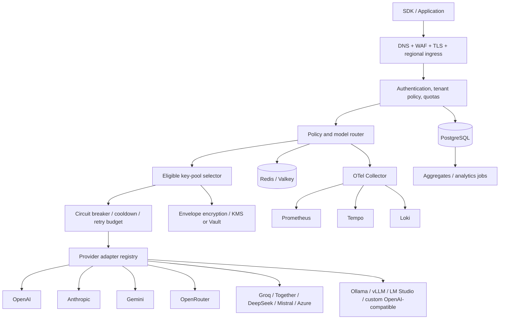

# API FLOW — Production Architecture Blueprint

**Status:** Architecture and implementation contract. This document distinguishes implemented code from target architecture; it is not a claim that every target capability is already deployed.

## 1. Product contract

API FLOW is a BYOK AI gateway. End users supply credentials to upstream model providers and remain responsible for their provider bills. API FLOW must never buy, resell, subsidize, or imply included inference credits. The platform may charge for its own infrastructure/product features only if billing is explicitly implemented and disclosed.

### Non-negotiable invariants
- Provider secrets are never returned to a browser after creation, included in logs, or committed to source control.
- Tenant identity comes from verified authentication/API-key records, never a user ID supplied in request JSON.
- Every provider credential, pool, policy, conversation, usage record, and audit event is tenant-scoped; team resources also require organization membership and role checks.
- Retry only when the request is safe to replay and the upstream error is retryable. Never silently retry a non-idempotent tool/action without an explicit idempotency contract.
- Cost/latency/quality routing uses known data and declared policy; no fabricated prices, scores, health, or analytics.
- Model/provider availability and price are dynamic; registry metadata must be timestamped and configurable.
- No “unlimited” claim means infinite capacity. The data model has no arbitrary small per-user key count, but fair-use, abuse, storage, and provider limits still apply.
- A healthy web process is not proof that provider credentials, provider connectivity, or a complete production deployment are healthy.

## 2. System context

### Request path
1. Enforce TLS, body limits, request ID, tenant authentication, organization policy, and abuse/rate limits.
2. Normalize the OpenAI-compatible request into an internal provider-neutral request while preserving caller options.
3. Resolve model aliases and evaluate routing policy (privacy, allowed providers, capabilities, geography, budget, latency, cost, quality).
4. Build an eligible route set using provider/model capability, pool membership, key state, quota state, policy, and tenant permissions.
5. Rank candidates deterministically using the chosen policy; use bounded randomized tie-breaking to avoid hot-key concentration.
6. Acquire a concurrency/lease token where required; decrypt a secret only in memory, immediately before the upstream call.
7. Invoke an adapter with timeout, cancellation, bounded retries, circuit-breaker state, and per-provider concurrency budget.
8. Retry another candidate only for configured retryable failures and within a global retry/deadline budget. Do not retry invalid requests, policy denials, or most 4xx errors.
9. Normalize the response, preserve useful upstream metadata, record usage/cost provenance, and return a stable error envelope if all routes fail.
10. Emit redacted telemetry and asynchronously persist aggregates. Do not put prompts or secrets into metric labels.

## 3. Target service boundaries

- **Gateway data plane:** stateless HTTP service; routing, adapter calls, streaming, retries, response normalization. Scale horizontally by region.
- **Control plane API:** tenant/org management, provider credentials, pools, policies, models, usage, audit, invitations, API tokens.
- **Credential service:** envelope encryption, key rotation, KMS/Vault integration, strict decrypt authorization, audit trails. No secret reads in general-purpose analytics.
- **Routing policy engine:** versioned, validated policies; deterministic evaluation and explainable decisions.
- **Health worker:** active/passive checks, latency/error windows, cooldown expiry, half-open probes, provider capability checks.
- **Usage pipeline:** append-only request outcomes and token counts; asynchronous aggregation into tenant/provider/model/time buckets.
- **Context service:** optional conversation/message storage, retention policies, encrypted sensitive content, retrieval integrations. Gateway should remain stateless when context persistence is disabled.
- **Admin/control UI:** operational state and tenant configuration; never displays full provider secrets.
- **Telemetry plane:** OpenTelemetry traces/metrics/logs with sampling, redaction, and cardinality budgets.

Avoid premature microservices in a small deployment; preserve these boundaries as modules and split services only when operational load or ownership justifies it.

## 4. Provider adapter contract

Each adapter implements:
- `id`, display name, supported authentication modes, supported modalities, model discovery capability, base URL validation.
- `validateCredential` (optional, explicit user-triggered), `listModels` (optional), `complete`, `stream`, `classifyError`, `normalizeUsage`.
- Provider-specific request/response mapping, timeout/cancellation, retry classification, and safe metadata.
- Configurable endpoints with SSRF protections for custom/local providers: reject loopback/link-local/private destinations unless explicitly enabled for self-hosted mode; validate DNS and redirects to prevent rebinding; never forward cloud metadata credentials.
- Capability descriptors: chat, tools, JSON mode, vision, audio, embeddings, context window, streaming. Do not route to unsupported capabilities.

Initial adapter sequence: OpenAI-compatible generic adapter, Groq, OpenRouter, OpenAI, Anthropic, Gemini, Together, DeepSeek, Mistral, Azure OpenAI, then local Ollama/vLLM/LM Studio. Each adapter needs contract tests with mocked upstreams and opt-in live tests.

## 5. Routing policy model

A policy is versioned JSON validated against a schema and compiled before activation:
- constraints: allowed/denied providers, models, regions, modalities, data classification, maximum estimated cost, minimum context, required capabilities.
- objective: `lowest_cost`, `lowest_latency`, `quality`, `availability`, `custom_priority`, `free_only`.
- ordered fallback graph and retry budgets.
- budget/deadline: maximum total attempts, maximum wall time, maximum estimated spend, concurrency.
- explainability: store policy version, candidate exclusion reasons, selected route, and fallback reason without storing credentials or prompt content.
- safe defaults: explicit provider/model allowlist; do not infer that “free model” means guaranteed free or unlimited. Provider terms, model availability, and limits are controlled by the provider.

Scoring uses normalized, time-decayed measurements with confidence/sample count. Hard constraints are applied before scoring. A suggested score is:
`score = w_cost * normalized_cost + w_latency * p95_latency + w_error * recent_error_rate + w_quality * quality_penalty + w_cold * cold_start_penalty`.
Weights and normalization are policy-versioned; no score can override privacy or capability constraints.

## 6. Failover and reliability

### Error classes
- Never retry: invalid request, unsupported capability, auth/policy denial, content/policy rejection unless policy explicitly permits a different provider and re-evaluates safety, malformed response caused by caller input.
- Usually retry next key: provider 429/quota exhaustion, 5xx, connection reset, DNS/transient network errors, timeout, circuit-open.
- Credential state: 401/403 marks a key suspect/invalid after classification; do not assume all 403 errors mean a bad key.
- Retry-after: honor provider `Retry-After` within caller deadline and tenant budget. Use capped exponential backoff with full jitter.
- Streaming: after response bytes have been sent, failover cannot transparently replace the stream. Only retry before headers/first byte or expose an explicit resumable-stream contract.
- Request hedging is opt-in, bounded, and disabled by default because it can double provider costs and duplicate side effects. BYOK still incurs user-side provider charges.
- Idempotency keys are scoped to tenant and request hash; never treat arbitrary POSTs as replay-safe.

### Circuit breaker states
`CLOSED → OPEN → HALF_OPEN → CLOSED`; rolling-window thresholds are per provider/model/credential endpoint, with minimum sample counts and cooldown. Health checks must be rate-limited. Recovery probes use a small concurrency allowance. A key is not marked healthy solely because a TCP connection succeeds.

### Retry budget
Use a global maximum attempt count, wall-clock deadline, provider-specific concurrency, per-tenant budget, and retry ratio. Prevent retry storms with jitter, admission control, queue limits, and load shedding.

## 7. Credential security

- Use envelope encryption: a random data-encryption key encrypts each provider secret with AES-256-GCM and unique nonce; a KMS/HSM/Vault key encrypts the data key. Persist ciphertext, nonce, auth tag, key version, and metadata—not plaintext.
- Prefer managed KMS/Vault in production; a single environment encryption key is only a transitional deployment option and must support rotation.
- Decrypt only in the data plane after tenant and route authorization; minimize plaintext lifetime and never cache plaintext long-term.
- Secret rotation supports dual-key version, re-encryption jobs, revocation, and audit.
- Browser receives only credential ID, provider, user label, masked suffix/prefix, creation/last-used timestamps, and state.
- Logs redact Authorization, API-key headers, request bodies by default, sensitive query parameters, and upstream error payloads that may echo secrets.
- Customer gateway tokens are high-entropy, shown once, stored as a hash, revocable, scoped, and optionally expiring.
- Use least-privilege service identities, short-lived credentials, SSO/MFA for operators, RBAC for team actions, CSRF protection for cookie sessions, origin checks, strict CORS, secure cookies, and admin audit.
- Define threat model for malicious tenants, compromised provider keys, SSRF via custom endpoints, prompt leakage, log exfiltration, supply-chain compromise, and cross-tenant cache leakage.
- Incident response: revoke affected keys, rotate encryption root, invalidate sessions, preserve redacted audit evidence, notify affected tenants according to policy.

## 8. Data model (PostgreSQL)

Core tables (all tenant data scoped by `organization_id` and/or `user_id`; add foreign keys, timestamps, indexes, RLS where appropriate):
- `users/profiles`: auth subject, display name, settings, created/updated.
- `organizations`, `organization_members`, `teams`, `team_members`: tenant boundaries and roles.
- `providers`: provider registry and adapter capabilities; mostly global read-only metadata.
- `models`: provider model ID, capabilities, context window, pricing metadata, currency, source, observed_at, valid_until.
- `provider_credentials`: id, owner scope, provider_id, label, ciphertext, nonce, tag, wrapped DEK, encryption key version, masked suffix, status, last_used_at, health summary, timestamps. No plaintext column.
- `key_pools`, `key_pool_members`: owner scope, pool type, policy, membership, priority, weights.
- `routing_policies`, `routing_policy_versions`: schema-validated config, immutable version, activated_by, activated_at.
- `gateway_tokens`: token hash, prefix, scopes, expiry, revoked_at, last_used_at.
- `requests`: request ID, tenant, model requested/selected, policy version, region, outcome, latency, input/output tokens, estimated cost, pricing provenance, timestamps; no raw prompt by default.
- `attempts` / `retries`: request ID, provider/model/credential IDs, attempt index, error class/status, latency, retry decision, redacted details.
- `responses`: optional metadata only; response body persistence is opt-in with retention/encryption.
- `health_checks`, `health_windows`: provider/model/credential status, latency percentiles, sample count, circuit state.
- `conversations`, `messages`: optional encrypted context, retention and deletion metadata.
- `usage_aggregates`, `cost_events`: tenant/provider/model/time bucket, tokens, request counts, cost estimate, pricing source.
- `audit_logs`: actor, action, target, timestamp, request ID, metadata allowlist; append-only.
- `notifications`, `feature_flags`, `webhook_deliveries`: delivery state, retries, signature version.
- `idempotency_records`, `quota_windows`, `outbox_events`: concurrency-safe idempotency, limits, reliable async publishing.

### PostgreSQL requirements
Use migrations, constraints, composite tenant-scoped foreign keys, partition large append-only request/attempt tables by time, indexes matching access patterns, retention/archival jobs, connection pooling, backups, point-in-time recovery, restore drills, and separate migration/analytics roles. RLS is defense-in-depth, not a substitute for API authorization. Never allow a client to write privileged usage/cost events directly.

## 9. Redis / queue design

Redis/Valkey is ephemeral coordination, not the system of record:
- `health:{provider}:{model}:{region}`: short TTL health snapshot.
- `breaker:{scope}:{credential_or_provider}`: state, open-until, failure counters; use atomic Lua/transactions.
- `rl:{tenant}:{window}`: atomic token/sliding window counters with expiry.
- `lease:{credential_id}`: short-lived concurrency lease with fencing token.
- `idempotency:{tenant}:{key}`: short TTL reservation/result reference; persistent source remains PostgreSQL.
- `session:{session_id}`: only if session storage is needed; secure cookie and TTL.
- `metrics:{region}:{bucket}`: temporary counters/histograms, periodically flushed.
Do not store raw provider secrets, full prompts, or unbounded logs in Redis. Use separate logical clusters or ACLs for cache and queue workloads; set max memory/eviction policies, TLS, auth, private networking, and tested failover.

At scale use a durable queue/outbox for usage events, health updates, notifications, and aggregation. Kafka/Redpanda is justified at high event throughput; smaller deployments can start with PostgreSQL outbox + managed queue without changing event contracts.

## 10. API surface

Version public control-plane APIs under `/v1`; maintain compatibility and publish OpenAPI:
- `POST /v1/chat/completions`, `POST /v1/responses` (where supported), streaming via SSE with cancellation.
- `GET /health/live`, `GET /health/ready`, `GET /health/providers` (authenticated detailed health; public health must not expose key counts if sensitive).
- `GET/POST /v1/credentials`, `POST /v1/credentials/:id/validate`, `DELETE /v1/credentials/:id`, `POST /v1/credentials/:id/rotate`.
- `GET/POST /v1/pools`, `PUT/DELETE /v1/pools/:id`, membership endpoints.
- `GET/POST /v1/routing-policies`, `POST /v1/routing-policies/:id/activate`.
- `GET /v1/providers`, `GET /v1/models`.
- `GET /v1/usage`, `GET /v1/analytics/*`, `GET /v1/requests/:id/attempts`.
- `GET/POST /v1/conversations`, message operations only when context persistence is enabled.
- `GET /v1/audit-logs`, team/org/member and role endpoints.
Every mutating endpoint needs schema validation, tenant authorization, audit, rate limits, pagination, idempotency where appropriate, and consistent error envelopes.

## 11. Frontend architecture

React + TypeScript app with a responsive app shell, accessible keyboard navigation, reduced-motion support, dark/light themes, typed API client, query cache, form validation, and server-derived data only.
1. Overview: real requests, success rate, p50/p95 latency, token totals, estimated costs with provenance, active provider health.
2. Credentials: add/test/revoke, provider/label/masked suffix/status, import preview; imported secret shown only during submission and never persisted in client analytics.
3. Pools: personal/team/shared scopes, membership and ordering.
4. Routing Studio: versioned policy editor with validation, dry-run/explain route and safe publish/rollback.
5. Failover visualizer: actual per-request attempts, status, latency, and retry decision.
6. Provider Center: model capability, status confidence, latency windows and freshness.
7. Analytics: filters, exports, retention boundaries and cost-source labels.
8. Security Center: members/roles, tokens, sessions, audit and retention controls.
9. Observability: request IDs, traces, redacted logs, metrics; role-restricted.
10. Settings: regions, budgets, retention, privacy, webhook and notification config.
No fake numbers, fake live activity, fake status, or buttons that claim unsupported operations succeeded.

## 12. Observability and SRE

- OpenTelemetry traces across ingress, policy evaluation, key selection, upstream request, persistence and response; propagate trace/request IDs.
- Prometheus metrics: request count/duration, upstream attempts, retry count, circuit transitions, active requests, queue depth, token counts, rate-limit events, credential decrypt failures. Avoid high-cardinality labels such as tenant IDs, request IDs, prompts, and key IDs.
- Grafana dashboards and alerts: availability, p95/p99 latency, upstream error ratio, retry amplification, saturation, queue lag, database pool exhaustion, Redis errors, secret service failures, budget burn.
- Loki structured logs with retention and redaction. Tempo trace sampling, elevated sampling for errors with strict sensitive-data scrubbing.
- SLO candidates: gateway availability, successful accepted requests, p95 overhead excluding upstream latency, control-plane availability. Set actual objectives only after baseline measurements.
- Runbooks: upstream incident, rate-limit storm, bad rollout, secret exposure, DB failover, Redis outage, queue backlog, regional failure, restore.
- Define error budget and freeze risky changes when burned. Test failover, backup restore, and incident drills.

## 13. Deployment and Kubernetes

### Early controlled production
Vercel or container hosting for web/control API, managed PostgreSQL, managed Redis/Valkey, managed KMS, provider egress allowlist, secret manager, OTel collector endpoint. One region first, clear backups and alerts.

### Multi-region target
- Global DNS/Anycast ingress and WAF; regional stateless gateway pools.
- Tenant home region for data residency; route only to permitted regions/providers.
- PostgreSQL primary with tested read replicas/DR and explicit consistency strategy; do not assume active-active writes are simple.
- Region-local Redis and telemetry; global control-plane config replication with versioned snapshots.
- Kubernetes: Deployment, HPA on concurrency/CPU/latency, PodDisruptionBudget, readiness/liveness probes, topology spread, resource requests/limits, non-root read-only containers, seccomp, network policies, workload identity, autoscaling, rolling/canary releases.
- Use Terraform or equivalent for repeatable infrastructure; GitOps for deployments; signed images/SBOM and dependency scanning.
- Never run model inference on platform-owned compute unless the product explicitly adds an opt-in self-hosted model mode with clear user-paid infrastructure.

### Capacity
100M requests/day averages ~1,157 requests/sec before peak factors. Size by measured request duration, streaming concurrency, token volume, payload size, provider rate limits, and database event write rate. Use load tests at 1x/2x/5x expected peak, admission control, queues only for asynchronous work, partitioned event storage, and a tested regional failover plan. No architecture document can honestly guarantee this capacity without benchmark results and provider quotas.

## 14. Cost model and no-inference-spend guarantee

- BYOK means provider billing is charged directly to the user's provider account wherever provider contracts support it.
- API FLOW must not silently proxy through platform-owned paid credentials or fallback to a paid platform key.
- Local providers are reached only through endpoints the user configures and is authorized to use.
- Display cost as provider-reported cost when available or an estimate with timestamped price source; distinguish unknown cost from zero.
- Protect the platform from abuse with quotas, payload limits, rate limits, tenant budgets, fair-use policies, and optional product billing for platform infrastructure.
- The owner still pays hosting, database, KMS, telemetry, egress, storage, and support. “Zero model costs” does not mean zero operating cost.
- Hedging or retries can create additional user-side model charges; make policy visible and default to bounded retries.

## 15. Security / privacy review checklist

- [ ] Threat model and data-flow review approved.
- [ ] Tenant isolation tests for every resource.
- [ ] KMS/Vault envelope encryption, rotation, and recovery tested.
- [ ] Secret redaction tests across logs, traces, errors, metrics, and browser.
- [ ] SSRF defenses and custom endpoint allowlist policy tested.
- [ ] Authentication, authorization, CSRF, CORS, session, token revocation tested.
- [ ] Dependency, SAST, container, and secret scanning in CI.
- [ ] Rate-limit and abuse tests, body size limits, timeouts, request cancellation.
- [ ] Data retention, deletion/export, privacy notices and provider terms documented.
- [ ] Backups, PITR, restore drill, incident response and key compromise runbooks.
- [ ] Penetration test and independent security review before enterprise claims.

## 16. Delivery plan and acceptance gates

1. **Security/data foundation:** tenant model, migrations, credential encryption, auth/RBAC, audit, RLS tests.
2. **Reliable data plane:** adapter interface, first providers, bounded failover, streaming semantics, request IDs, contract tests.
3. **Control plane:** credentials and pools APIs/UI, routing policy schema, dry-run and versioning.
4. **Observability:** OTel, metrics, logs, trace links, real usage aggregation.
5. **Context and analytics:** opt-in conversation persistence, retention/deletion, pricing provenance, analytics rollups.
6. **Production hardening:** load tests, chaos/fault injection, secret rotation drills, backup restore, threat model, SLOs.
7. **Scale-out:** queue/event pipeline, partitioning, regional deployment, Kubernetes, disaster recovery.
8. **Enterprise controls:** SSO/MFA, SCIM if required, team policies, compliance program and independent audit.

A stage is complete only when its tests, runbooks, migrations, dashboards, rollback plan, and deployment evidence exist. Do not mark a capability “production ready” based on UI presence or a passing frontend build alone.

## 17. Current repository status

The existing API FLOW repository has an Express/TypeScript gateway, a React landing page, a basic Groq/OpenRouter adapter path, and a Supabase-backed customer-key foundation. That is a useful base, but it is not yet the entire target architecture described above. Provider credential encryption for end-user BYOK, the full provider registry, streaming, Redis, KMS/Vault, Kubernetes, multi-region routing, and the complete enterprise console require implementation and verified deployment before they can be advertised as available.
